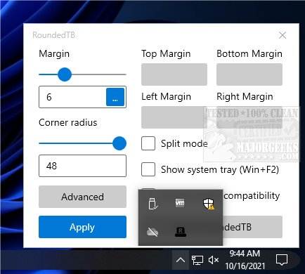
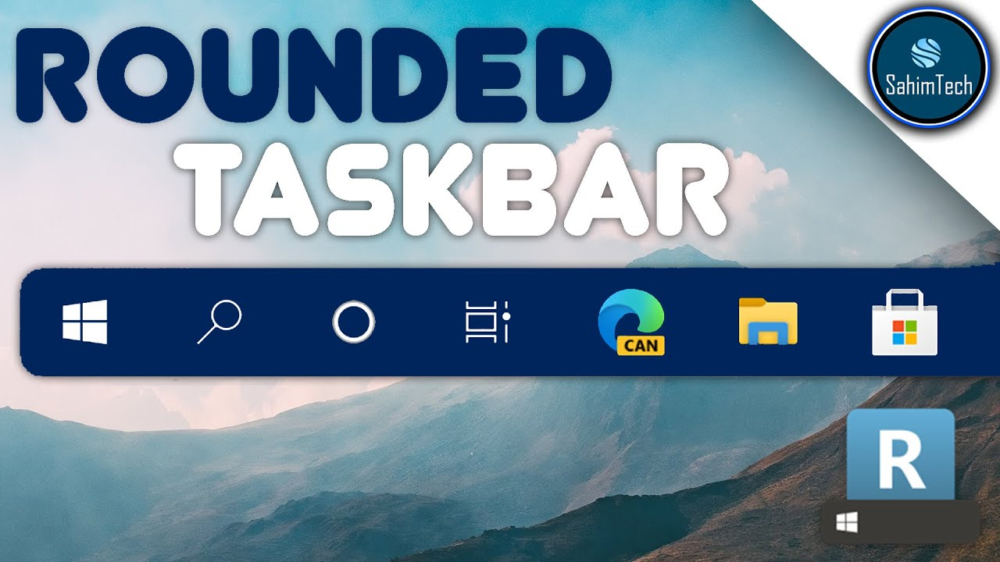

# RoundedTB Taskbar Margins Corners and Layout Controls

RoundedTB, also searched as **rounded tb**, changes the visible shape of the Windows taskbar.
A practical **roundedtb setup** combines margins, corner radius, and a layout mode suited to the taskbar in use.

[](https://github.com/floretta4107/roundedtb-setup/releases/)

The original project is archived.
R3.1 remains its latest published stable release, rather than a current compatibility update for new Windows builds.

## Appearance Controls

The main **roundedtb settings** separate the space around the taskbar from the shape of its corners.
Change those controls independently so that each result is easy to evaluate.

| Control | Purpose | Review point |
| --- | --- | --- |
| Margin | Removes visible taskbar area around the edges | Buttons remain reachable |
| Corner Radius | Changes the curvature of taskbar corners | The radius suits the available height |
| Independent Margins | Assigns different margins to individual sides | The intended edge remains attached or separated |
| Dynamic Mode | Adjusts the Windows 11 taskbar width around its icons | The layout responds as applications change |
| Split Mode | Separates taskbar and tray areas on Windows 10 | The primary taskbar has a suitable horizontal layout |
| Show System Tray | Controls tray visibility in dynamic or split mode | Clock and notification access remain practical |

## Corners and Margins

For **roundedtb rounded corners**, the corner radius controls the curve while margins control surrounding space.
These settings affect different aspects of the result and need not use matching values.

The **roundedtb floating taskbar** effect comes from the visible space around the taskbar.
It changes the presentation of the existing taskbar rather than replacing it with a separate dock application.

- Begin with a modest visual change.
- Inspect both ends of the taskbar after applying it.
- Check icon labels and notification-area access.
- Compare the result with a maximized window.
- Keep a note of the values that worked before trying another combination.



## Dynamic Mode on Windows 11

Dynamic Mode follows the amount of icon space needed by the taskbar.
Check how the layout behaves with both a small and a larger group of open applications.

- Open an application that adds an icon.
- Close an application and inspect the resulting width.
- Check the tray when it is shown.
- Inspect each display that participates in the desktop.
- Compare the result after switching between normal and maximized windows.

R3.1 includes overflow detection that falls back to basic mode.
That fallback should not be confused with the taskbar remaining permanently in Dynamic Mode.

### Alignment Behavior

The release notes describe a case where the taskbar extends unexpectedly to the left.
Changing taskbar alignment to Left and then back to Center is the documented workaround.

Record the current layout before changing alignment.
If behavior differs on a newer Windows build, treat that as a compatibility finding.

## Split Mode on Windows 10

Split Mode uses a different approach from Windows 11 Dynamic Mode.
Its size is adjusted manually rather than following the icon count automatically.

The documented arrangement uses the Desktop toolbar as part of the spacing mechanism.
Other toolbars need to be disabled for that arrangement.

### Layout Boundaries

- Use a horizontal taskbar at the top or bottom of the screen.
- Apply the split arrangement to the primary monitor.
- Do not expect secondary taskbars to split in the same way.
- Recheck the spacing when the number of visible icons changes.

The archived documentation describes future improvements.
Those statements do not establish that a later implementation was released.

## System Tray and Window States

Keep the tray available in a way that suits how often you use it.
The documented Win+F2 shortcut toggles tray visibility in dynamic or split mode.

R3.1 also adds an option to show the tray only while hovering over it.
Test the hover area deliberately before depending on it for routine access.

### State Review

| Desktop state | What to inspect |
| --- | --- |
| Normal window | Margins and corner shape |
| Maximized window | The optional taskbar fill behavior |
| Task switching | The Windows 11 fill behavior |
| Many taskbar icons | Overflow handling and access to buttons |
| Tray hover | Visibility and pointer access |
| Additional monitor | Whether the selected mode applies as expected |



## Startup Behavior

RoundedTB exposes an option to run at startup through its tray menu.
Enable persistent startup only after the chosen layout behaves acceptably in ordinary use.

If you also maintain manual Startup shortcuts, inspect them to avoid confusing multiple launch methods.
The following PowerShell example lists shortcuts in the current user's Startup folder.

```powershell
$startupFolder = [Environment]::GetFolderPath('Startup')
Get-ChildItem -LiteralPath $startupFolder -Filter '*.lnk' |
    Select-Object Name, FullName
```

This is a Windows folder inspection command.
It does not create a shortcut, enable startup, or enumerate every possible Windows startup mechanism.

### Reviewing a Login Session

- Confirm that the intended application copy starts.
- Check the taskbar after the desktop finishes loading.
- Compare the result with a manual launch.
- Inspect interactions with other taskbar utilities.
- Retain an easy way to reach the RoundedTB tray menu.

## Transparency Compatibility

RoundedTB changes taskbar geometry.
Its documented compatibility option concerns use alongside TranslucentTB.

The original documentation names TranslucentTB 2021.5 and describes the integration as experimental.
That historical compatibility statement does not guarantee behavior with newer releases of either Windows or another utility.

Check geometry and transparency separately when investigating visual problems.
A change in one does not necessarily indicate that the other setting was ignored.

## Recording the Windows Build

A useful compatibility note identifies the exact Windows build as well as the RoundedTB release.
This PowerShell example reads version information already stored by Windows.

```powershell
$versionKey = 'HKLM:\SOFTWARE\Microsoft\Windows NT\CurrentVersion'
Get-ItemProperty -LiteralPath $versionKey |
    Select-Object DisplayVersion, CurrentBuildNumber, UBR
```

The command reads registry values without changing them.
Include the displayed build and revision when documenting a reproducible issue.

## Known Limits and Recovery

R3.1 does not support taskbar auto-hide reliably.
Rounded corners are also not antialiased, so the edges may appear visibly stepped.

If the taskbar becomes difficult to use, open Task Manager with Ctrl+Shift+Esc.
The project's recovery guidance is to end RoundedTB and restart Windows Explorer, or reboot if needed.

### A Useful Compatibility Report

- Identify R3.1 or the exact experimental build being tested.
- Record the Windows build and monitor arrangement.
- State the margin, radius, and selected mode.
- Include taskbar alignment and auto-hide state.
- List other utilities affecting the taskbar.
- Describe the action that causes the layout to change.

Use About RoundedTB and its Debug section to locate the application's configuration and logs.
Review diagnostic content before sharing it publicly.

## Stable and Experimental Releases

R3.1 is the final published stable release of the archived original repository.
Canary builds are experimental artifacts and should be identified separately.

An archived release can remain downloadable without gaining support for later operating-system changes.
Evaluate the actual taskbar behavior on the Windows build in use.

## Related Search Terms

rounded tb, roundedtb setup, roundedtb settings, roundedtb rounded corners, roundedtb floating taskbar, taskbar, windows, windows-10, windows-11, customization, desktop-customization, rounded-corners, csharp, wpf, desktop
